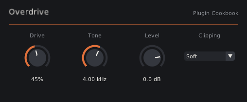

# Plugin Cookbook

Turn a sound-design idea into a working **desktop audio plugin** — VST3, AU, CLAP, LV2 and a
standalone app for Windows, macOS and Linux — without writing build files or UI code. You describe the
effect in plain language; an AI writes a single recipe file; GitHub (or your machine) builds it.

Inspired by [MOD Audio's plugin cookbook](https://github.com/mod-audio/mod-plugin-cookbook), which does
the same for MOD hardware. Built on [DPF](https://github.com/DISTRHO/DPF) and
[Dear ImGui](https://github.com/ocornut/imgui).

<p align="center"></p>

```
  your idea ──► AI ──► my-effect.plugin.toml ──► recipe.py ──► DPF ──► VST3 · AU · CLAP · LV2 · Standalone
                          (DSP + parameters)       │                    + generated knob UI
                                                   └──► test harness (NaN, allocations, channels, CPU…)
```

## For humans

### Path A — no tools installed (GitHub builds it)

1. On GitHub, *Fork* this repository (a fork keeps the `dpf` submodules the build needs). Make sure
   *Actions* are enabled in your fork's *Actions* tab.
2. Open a conversation with an AI that can read links (Claude, ChatGPT, Gemini…) and send it the link
   to **your** repository's `prompts/plugin-from-idea.md`, or paste that file's contents.
3. Describe the plugin you want: *"a tape saturation with drive, tone and output"*,
   *"a slow stereo tremolo"*, *"a ping-pong delay that gets darker on every repeat"*.
4. The AI proposes the knobs and ranges; confirm or adjust. It returns one `<id>.plugin.toml` file.
5. In your repository, open `plugins/` → *Add file* → *Create new file*, name it exactly as the AI
   said, paste, *Commit changes*.
6. Open the *Actions* tab. When the run finishes, download the artifact for your system:
   - **Windows**: copy `*.vst3` to `C:\Program Files\Common Files\VST3`, `*.clap` to `C:\Program Files\Common Files\CLAP`. The `.exe` is the standalone app.
   - **macOS**: the `.dmg` contains an installer `.pkg` for AU/VST3/CLAP/LV2 and the standalone `.app`s.
   - **Linux**: copy to `~/.vst3`, `~/.clap`, `~/.lv2`. The extension-less binary is the standalone.
7. Rescan plugins in your DAW.

If the *recipes* job fails, copy its log into the AI conversation; it will fix the recipe.
Pushing a git tag (e.g. `v1.0.0`) also publishes a GitHub Release with all archives.

> The binaries are not code-signed. On macOS, if a plugin is blocked, run
> `xattr -dr com.apple.quarantine ~/Library/Audio/Plug-Ins/*/<name>.*`; on Windows, SmartScreen may ask
> for confirmation the first time the standalone runs.

### Path B — local build

Requirements: git, CMake ≥ 3.15, a C++17 compiler, Python ≥ 3.11.
On Linux also: `libgl1-mesa-dev libx11-dev libxcursor-dev libxext-dev libxrandr-dev libasound2-dev libdbus-1-dev` (and `libpulse-dev` for PulseAudio in the standalone).
On macOS: Xcode command line tools.

```sh
git clone --recursive <your-repo-url> && cd <repo>
python3 tools/recipe.py new my-effect            # scaffold plugins/my-effect.plugin.toml (or paste the AI's file)
python3 tools/recipe.py test my-effect           # compile the DSP natively and run the test suite
python3 tools/recipe.py render my-effect in.wav out.wav --set drive=80   # listen offline
python3 tools/recipe.py build                    # all formats, into build/bin/
python3 tools/recipe.py install                  # copy into this user's plugin folders
```

`build` accepts recipe names (`build my-effect`), `--formats vst3,clap` and `--no-ui`. Plain CMake works
too: `cmake -S . -B build && cmake --build build`.

### The standalone app

Every recipe also builds as a standalone app (`<id>.app` on macOS, `<id>.exe` on Windows, `<id>` on
Linux): the same controls plus a bar with input/output meters and an **Audio settings** button. There
you pick the audio system (Core Audio; WASAPI; ALSA or PulseAudio), the input and output devices,
which channels to use, the sample rate (only rates both devices support) and the buffer size.
Changes apply immediately. A mono plugin plays on both output channels; a stereo plugin fed by a single
input channel gets it on both inputs.

Settings and knob positions are remembered in `standalone.ini`, in
`~/Library/Application Support/<id>/` (macOS), `%APPDATA%\<id>\` (Windows) or `~/.config/<id>/` (Linux),
with dashes in the id replaced by underscores.

On macOS the first launch asks for microphone access; if you deny it, the input stays silent until you
allow it in *System Settings → Privacy & Security → Microphone*. Windows uses WASAPI in shared mode
(no ASIO). DPF's own standalone, which always uses the default devices at 48 kHz, is still available
with `--formats jack`.

## For AIs

If a user sent you this repository and wants a plugin, your full instructions are in
[`prompts/plugin-from-idea.md`](prompts/plugin-from-idea.md). Fetch that file and follow it.

Short version: propose the plugin's shape (name, brand, category, channels, knobs with ranges) for the
user to confirm, then output one complete `<id>.plugin.toml` with a `[plugin]` table, `[[param]]`
tables and a `[dsp]` C++ `Kernel` class (`prepare` / `reset` / `process`), using
[`examples/gain.plugin.toml`](examples/gain.plugin.toml) as the template.

## What the test suite checks

`python3 tools/recipe.py test` builds the kernel with the same engine the plugins use and runs:

| Test | Catches |
|---|---|
| static checks | allocation, I/O, locks or exceptions in `process()`; disallowed includes; `out[2]` on a stereo plugin; unused parameters |
| channels | reading inputs that don't exist, writing extra outputs, leaving output samples unwritten |
| stability | NaN/Inf or runaway levels at 44.1/48/96/192 kHz × defaults/min/max/random settings × sine/noise/impulse |
| automation | blow-ups when every parameter jumps every block with random block sizes |
| realtime | heap allocations inside `process()` (instrumented `new`/`malloc`) |
| silence, tail, DC | self-oscillation, feedback that never decays, DC offset |
| reset, block size | state that `reset()` forgets; output that depends on the host's buffer size |
| cpu | % of one core at 48 kHz |

`--sanitize` rebuilds with AddressSanitizer/UBSan to catch out-of-bounds buffer access.
`FAIL` must be fixed; `WARN` is advice.

The CI additionally runs [pluginval](https://github.com/Tracktion/pluginval)-style validation through
DISTRHO's build action. Locally, the examples pass `pluginval --strictness-level 10` (including editor
tests) and `clap-validator`.

## Repository layout

```
plugins/                 your recipes (*.plugin.toml). When empty, the examples are built instead.
examples/                reference recipes: gain, overdrive, chorus, multimode-filter, stereo-delay
prompts/                 plugin-from-idea.md — the instructions an AI follows
framework/include/cookbook/
    dsp.hpp              helper DSP library available to recipes (filters, delay lines, LFO, oversampler…)
    Engine.hpp           smoothing, block splitting, denormals, safety net — shared by plugins and tests
    ParamInfo.hpp        parameter metadata
    Controls.hpp         generic Dear ImGui controls (knobs, toggles, drop-downs), shared by editor and app
framework/src/
    CookbookPlugin.cpp   generic DPF plugin wrapper
    CookbookUI.cpp       plugin editor: connects the shared controls to the host
    CookbookStandalone.cpp  standalone app: Engine + RtAudio + audio settings panel
tools/recipe.py          validate / generate / test / render / build / install
tools/harness/           offline test harness
dpf/, dpf-widgets/       git submodules (DISTRHO Plugin Framework and its widgets)
.github/workflows/       CI: tests + Linux, macOS (universal) and Windows builds
```

## How a recipe becomes a plugin

`tools/recipe.py generate` validates the TOML and emits three headers per plugin into
`build/generated/<id>/`: `DistrhoPluginInfo.h` (IDs, channel counts, categories for LV2/VST3/CLAP/AU),
`RecipeMeta.hpp` (parameter table and the `Params` struct) and `RecipeKernel.hpp` (the recipe's code,
with `#line` directives so compiler errors point into the `.plugin.toml`). The two framework source
files are compiled against them once per plugin by `dpf_add_plugin`. CMake re-runs the generator
whenever a recipe changes.

## Licensing

The cookbook (framework, tools, prompts, examples) is MIT — see [LICENSE](LICENSE). Plugins you build
also contain [DPF](https://github.com/DISTRHO/DPF) (ISC), [pugl](https://github.com/DISTRHO/pugl) (ISC),
[DPF-Widgets](https://github.com/DISTRHO/DPF-Widgets) (ISC) with [Dear ImGui](https://github.com/ocornut/imgui)
and imgui_toggle (MIT). All are permissive; keep their notices when you distribute binaries. VST3 support
comes from DPF's own implementation, so no Steinberg SDK license is involved. VST is a trademark of
Steinberg Media Technologies GmbH; AU of Apple Inc.
